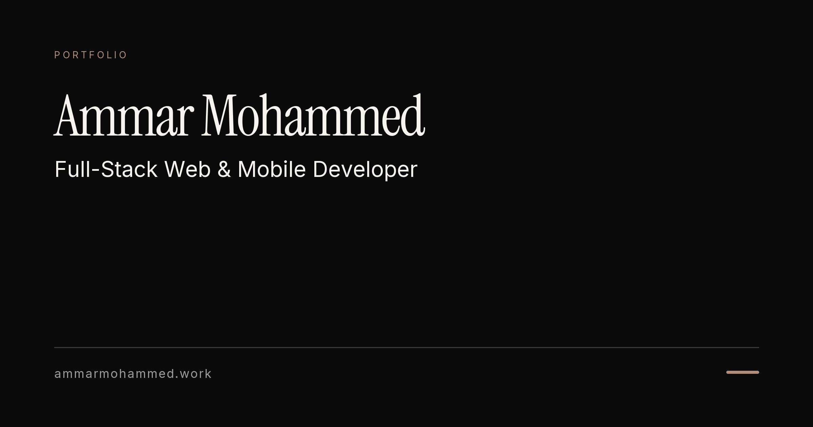

<!--
  GitHub profile README for https://github.com/Ammarmyp
  Copy this file and banner.png to the root of the Ammarmyp/Ammarmyp repository.
  Palette: #0a0a0a (black) / #f5f4f0 (off-white) / #b08f7a (accent)
-->

 

 

## About

I build production web and mobile products, from APIs and auth to cross-platform apps and polished interfaces.

- 📍 Based in **Addis Ababa**
- 🎓 B.Sc. in Software Engineering at **Addis Ababa Science and Technology University**
- 🟢 Open to **full-time and remote roles** and **freelance projects**

 

## Capabilities

| | |
| :-- | :-- |
| **Frontend** |      |
| **Backend** |      |
| **Mobile** |     |
| **Platform** |     |

 

## Activity

  
  &nbsp;&nbsp;
  

  

